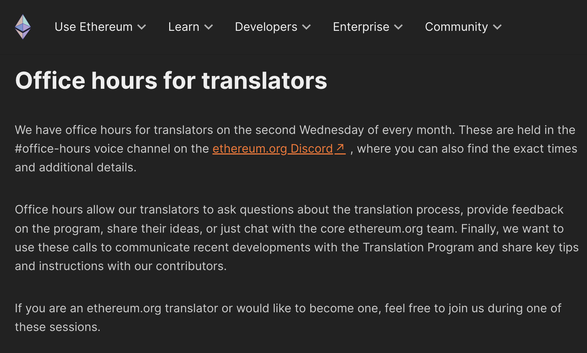
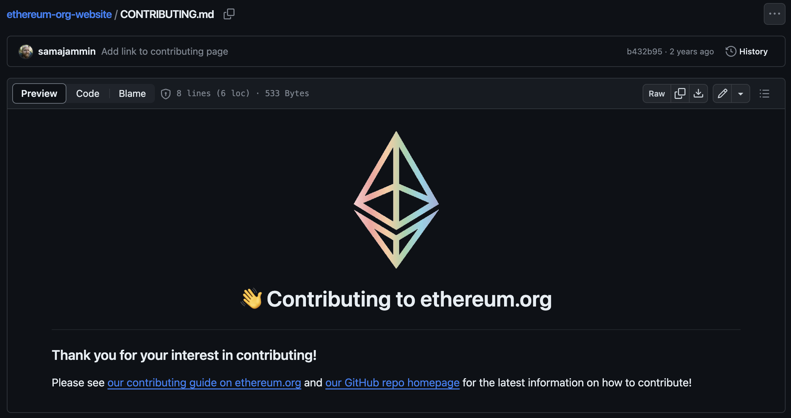
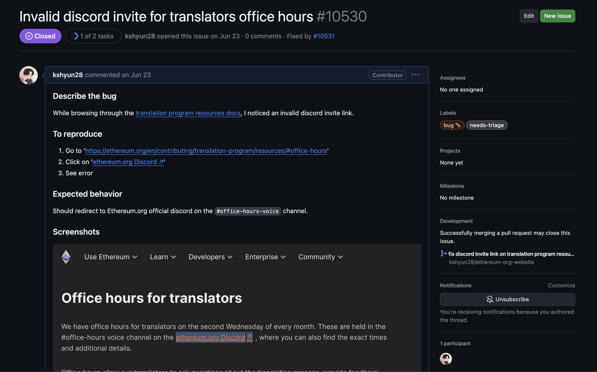
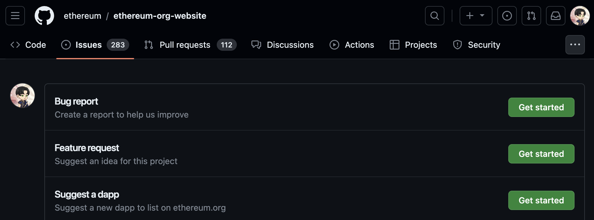
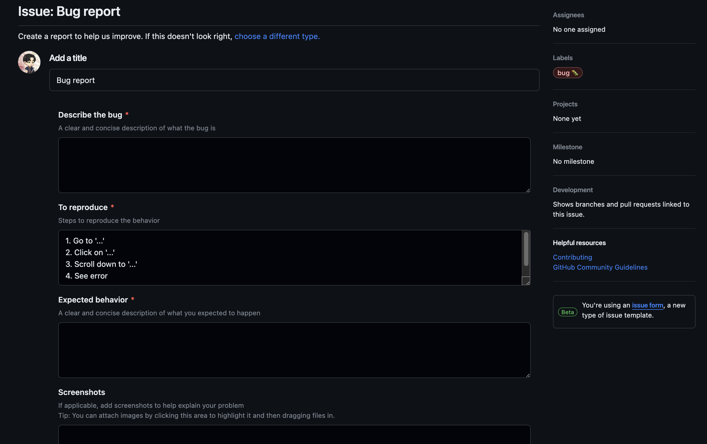
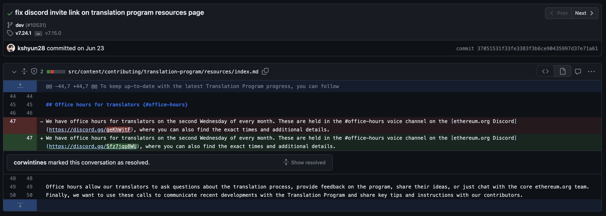
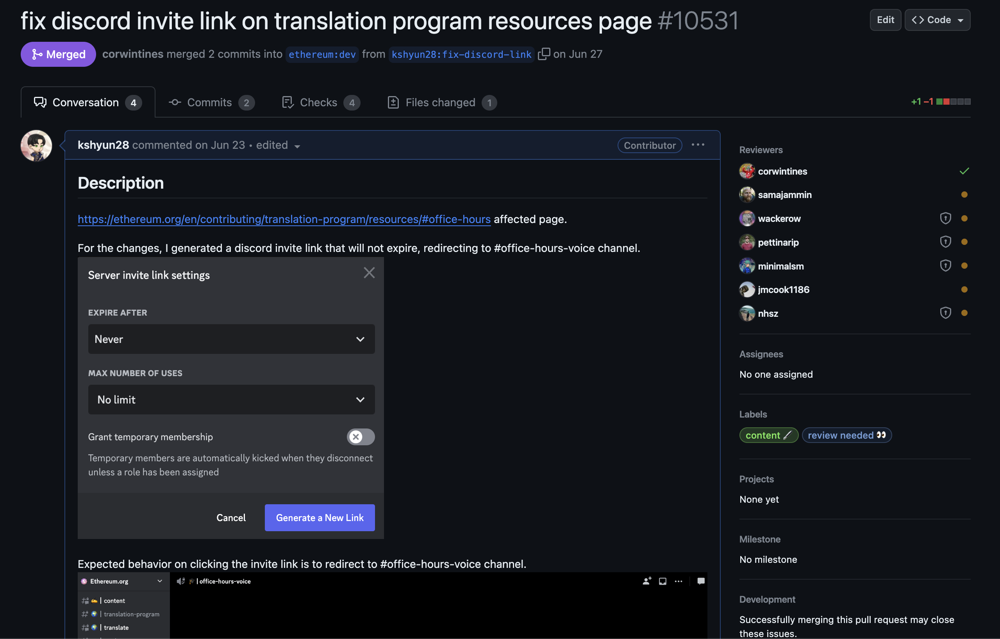
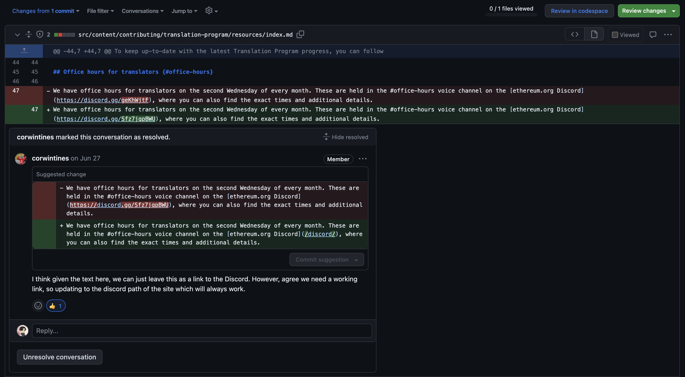
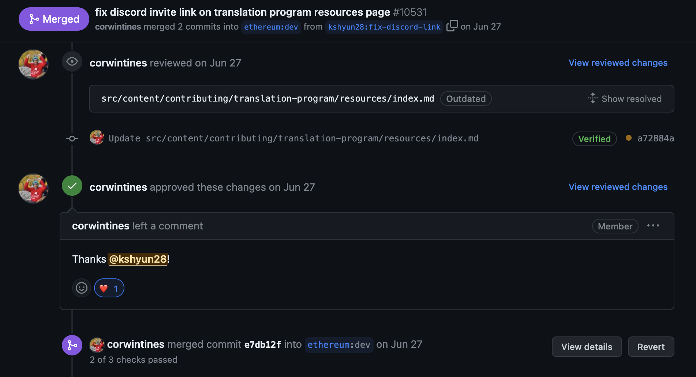
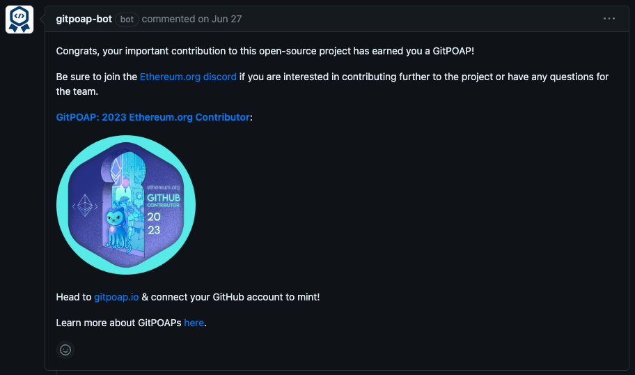

## Introduction

As a software engineer who has never contributed to [open-source](https://opensource.com/resources/what-open-source) before 2023, I've been looking for ways to contribute. Being passionate about [Web3](https://ethereum.org/en/web3/), I looked for interesting projects in this space. It was not hard to find one where I could contribute since Web3 is about **openness** and **decentralization**. Eventually, I found a project where I made my first [open-source contribution](https://dev.to/jdg2896/my-first-open-source-contribution-how-i-did-it-1jh6) which is [Taiko](https://taiko.xyz/), a [type 1 ZK-EVM](https://taiko.mirror.xyz/w7NSKDeKfJoEy0p89I9feixKfdK-20JgWF9HZzxfeBo). 

After my first open-source contribution, I looked for other projects where I could contribute. One of those projects was [Ethereum](https://ethereum.org/en/), which is a blockchain network that enables [Decentralized Finance](https://ethereum.org/en/defi/), [tokenization of assets](https://ethereum.org/en/nft/), and an [open internet](https://ethereum.org/en/dapps/?category=technology). While reading through their contributing guidelines, I found an issue in their documentation and ended up fixing it, making my second open-source contribution.

In this article, I'll be sharing my journey on how I contributed exactly one line of code to one of Ethereum's open-source repositories, [Ethereum.org](https://github.com/ethereum/ethereum-org-website). 

## Looking for ways to contribute to Ethereum

Ethereum has a lot of open-source repositories on their [GitHub](https://github.com/ethereum). 

Some notable repositories I was looking at were:
- [Geth](https://github.com/ethereum/go-ethereum) - Official Go implementation of the Ethereum protocol.
- [Solidity](https://github.com/ethereum/solidity) - Smart contract programming language.
- [Remix](https://github.com/ethereum/remix-project) - Browser-based compiler and IDE for Ethereum smart contracts written with Solidity.
- [Ethereum.org](https://github.com/ethereum/ethereum-org-website) - Official website and online resource for the Ethereum community.

When choosing which repository I could contribute to, I had to consider my current skill sets. 

Being proficient in [JavaScript](https://developer.mozilla.org/en-US/docs/Web/JavaScript) and [TypeScript](https://www.typescriptlang.org/), Geth and Solidity are out of the question, since Geth requires knowledge of [Go](https://go.dev/), while Solidity requires knowing [C++](https://isocpp.org/). 

Remix on the other hand is mostly written in [TypeScript](https://www.typescriptlang.org/), while Ethereum.org uses [Markdown](https://www.markdownguide.org/). These are the Ethereum projects that I focused on contributing to.

## Finding a bug on Ethereum.org's website

After choosing Ethereum.org as a potential repository where I could contribute, I reviewed their website's [contributing](https://ethereum.org/en/contributing/) section.

While browsing through the different [ways to contribute](https://ethereum.org/en/contributing/) to Ethereum.org, I saw their [translation program](https://ethereum.org/en/contributing/translation-program/) and checked if I could contribute by translating their documentation. As I was reading through the [translation program resources page](https://ethereum.org/en/contributing/translation-program/resources), I noticed a broken Discord link in the [Office hours for translators section](https://ethereum.org/en/contributing/translation-program/resources/#office-hours). 

The Discord link should redirect to [Ethereum.org's Discord server](https://discord.com/invite/rZz26QWfCg). Instead, I got an `Invite Invalid` error message.

## Reviewing Ethereum.org's open-source contribution guidelines

Before proceeding to fix the invalid Discord invite link, I reviewed Ethereum.org's [CONTRIBUTING.md](https://github.com/ethereum/ethereum-org-website/blob/dev/CONTRIBUTING.md) file to make sure I was following their open-source contributing guidelines. 

The guide pointed to the contributing sections in Ethereum.org's [website](https://ethereum.org/en/contributing/) and [README.md](https://github.com/ethereum/ethereum-org-website/tree/dev#-welcome-to-ethereumorg).

## Creating an issue on Ethereum.org's GitHub repository

After reviewing the contributing guidelines, I looked at existing [issues](https://github.com/ethereum/ethereum-org-website/issues) to see if someone else had already reported the **broken Discord invite link** on the **translation program resources page**. 

Once I verified that no one else reported the issue, I created an [issue](https://github.com/ethereum/ethereum-org-website/issues/10530) on Ethereum.org's GitHub repository. 

Creating an issue was easy since there are templates for different types of issues. In my case, I needed to create a **Bug report issue**. 

## Forking Ethereum.org's repository and testing the fix

After creating the issue, I [forked Ethereum.org's GitHub repository](https://github.com/jdg2896/ethereum-org-website) and followed their [local environment setup guide](https://github.com/ethereum/ethereum-org-website#3-set-up-your-local-environment-optional). Once I've set up my local environment, I started working on the fix. 

The fix was easy since I only needed to replace the Discord invite link with a working one. 

I tested the fix locally to verify that the translation page is still working and that my commit fixed the issue. 

## Creating a pull request on Ethereum.org's GitHub repository

After verifying that my commit fixed the [issue](https://github.com/ethereum/ethereum-org-website/issues/10530), I created a [pull request](https://github.com/ethereum/ethereum-org-website/pull/10531) to Ethereum.org's repository with the fix for the invalid Discord invite link.

## Pull request reviewed and merged!

After creating the pull request, I waited for the code owners and maintainers to review the pull request. 

A few days later, [corwintines](https://github.com/corwintines) reviewed my [pull request](https://github.com/ethereum/ethereum-org-website/pull/10531). In his code review, he gave valuable feedback and updated my code changes by replacing the Discord invite link with the official Ethereum.org Discord invite link.

Then, he approved and merged my pull request. He also thanked me for my contribution, which left a warm feeling even though I only contributed one line of code (less than that if you consider that he updated my code changes).

After the pull request was merged, I also got a [GitPOAP](https://www.gitpoap.io/), as recognition for my contribution to Ethereum.org in 2023.

## Conclusion

In this journey, I've learned that it is possible to make small contributions to large projects such as Ethereum. The beauty of open-source is that anyone can make changes, **no matter how small**. In fact, the majority of open-source contributions fix small issues like the one I encountered. These small changes are also easier for the open-source maintainers to review. 

As the scouts' saying goes, "Always leave the campground cleaner than you found it". For us open-source contributors and software engineers, we should also leave the codebase **better than we first saw it**. That means if you see a mistake on an open-source documentation, you can suggest a fix to the maintainers. 

If you're looking to make open-source contributions yourself, I hope my story has inspired you to do the same.

Thank you for reading! If you have any questions or feedback, I'd love to hear from you.

